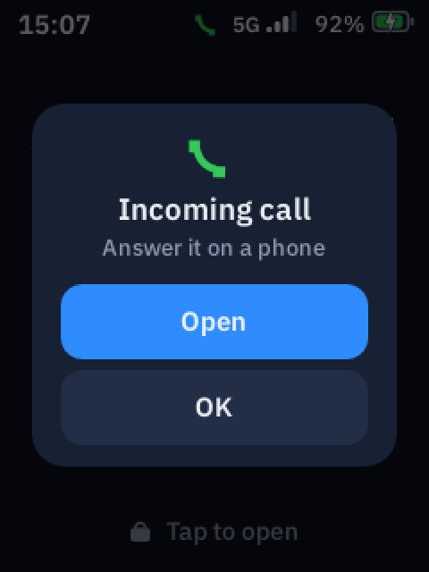
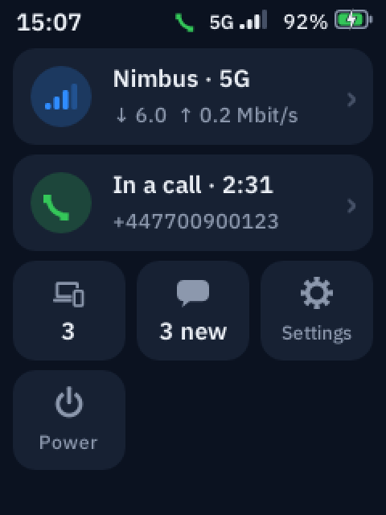
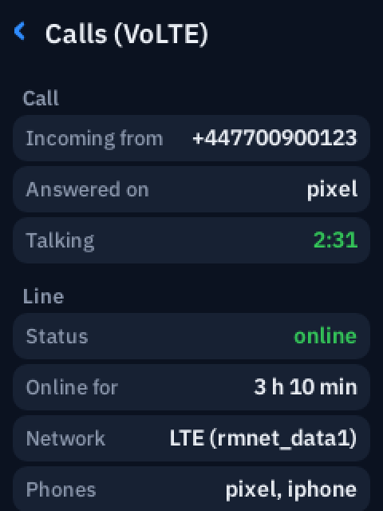

[English](README.md) | **Español**

# MudiVoLTE: llamadas y SMS en el GL.iNet Mudi 7

> Este es un fork de [xarvel/MudiVoLTE](https://github.com/xarvel/MudiVoLTE) adaptado para Chile
> (eSIM, numeración chilena, español). Sus paquetes y su instalador vienen de
> las [versiones publicadas de este fork](https://github.com/davasquezg/MudiVoLTE-CL/releases); reporta los
> problemas con ellos en [sus issues](https://github.com/davasquezg/MudiVoLTE-CL/issues).

El GL.iNet Mudi 7 (GL-E5800) tiene un módem 5G, el Quectel RG650V, que
oficialmente solo hace datos: las llamadas a su SIM no llegan a ninguna parte.
MudiVoLTE convierte el router en una línea telefónica para esa SIM. Los teléfonos
conectados al Wi-Fi del router usan una app SIP gratuita (Linphone): suenan con
las llamadas entrantes y hacen llamadas salientes a través de la SIM, con sonido
en ambos sentidos, y reciben los SMS de la SIM como mensajes de chat, que pueden
responder.

Todo funciona en el propio router. Es un solo paquete de OpenWrt, `mudi-volte`,
que se instala con un solo comando.

**Probado:** Mudi 7 con firmware GL 4.10.0 y la SIM de un operador europeo,
Linphone en Android y iPhone. Llamadas entrantes y salientes en banda ancha
(wideband) (AMR-WB hacia la red, G.722 hacia el teléfono), llamadas entre los
teléfonos, SMS en ambos sentidos entre la red y un teléfono SIP, configuración
del teléfono por código QR, llamadas cifradas (SIP sobre TLS, SRTP), llamadas
entrantes en un iPhone con Linphone en segundo plano (push), un teléfono fuera
de casa a través de Tailscale (inicio de sesión y la prueba de eco), páginas web
en el panel de administración de GL y en LuCI, llamadas entrantes con una
segunda SIM o la eSIM integrada activa junto a la SIM de la línea. En 4.10.2: la
actualización del firmware desde 4.10.0 con Keep Settings (conservar la
configuración), el registro y una llamada entrante contestada en un iPhone
despertado por una notificación push.

> **Antes de empezar.** No se garantiza que los números de emergencia (112, 911,
> 999 y similares) funcionen a través de MudiVoLTE: mantén un teléfono con su
> propia SIM para ellos. Ejecutar el cliente IMS del operador en un router puede
> ir en contra de las condiciones de tu contrato móvil; revísalas. MudiVoLTE es
> un proyecto personal, probado con un solo operador, y se entrega sin ninguna
> garantía (ver [LICENSE](LICENSE)).

## Lo que necesitas

- Un GL.iNet Mudi 7 (GL-E5800) con firmware GL 4.x.
- Una SIM de un operador que ofrezca VoLTE para ella: la nano-SIM de la ranura
  1, o la de la ranura 2 o la eSIM integrada (que ocupa el lugar de la SIM 2). La
  configuración elige la primera ranura con una SIM lista, primero la 1;
  `mudi-volte.main.sim_slot` elige otra. Probado con un operador europeo en la
  SIM 1; la línea en la SIM 2 o en la eSIM aún no se ha probado en un router.
  Otros operadores deberían funcionar si permiten VoLTE para la SIM; abre un
  issue y cuenta cómo te fue. La otra SIM puede quedarse en el router (ver
  [Limitaciones conocidas](#limitaciones-conocidas)).
- Un teléfono, tablet o computador con Linphone (gratuito: Android, iPhone,
  macOS, Windows, Linux).
- Opcionalmente: una cuenta gratuita en
  [subscribe.linphone.org](https://subscribe.linphone.org), para que las
  llamadas suenen en un iPhone mientras Linphone está en segundo plano (ver
  [Teléfonos en segundo plano](#teléfonos-en-segundo-plano)).
- Un computador con SSH para la instalación. SSH viene incluido en macOS, Linux
  y Windows 10/11.

## Instalación

**1. Inicia sesión en el router.** Conecta tu computador al Wi-Fi o a un puerto
LAN del router. Abre una terminal (Terminal en macOS y Linux, PowerShell en
Windows) y ejecuta:

```sh
ssh root@192.168.8.1
```

La contraseña es la contraseña de administración del router, la que usas para
su panel web.

**2. Ejecuta el instalador.**

```sh
wget -qO- https://github.com/davasquezg/MudiVoLTE-CL/releases/latest/download/install.sh | sh
```

**En español.** Si la versión publicada trae el paquete de traducción
(`mudi-volte-i18n-es_<versión>_all.ipk` en la página de versiones), agrega
`MUDI_VOLTE_LANG=es` antes de `sh`: el instalador también instala ese paquete y
la configuración, la línea de comandos y la página del panel de administración
de GL quedan en español:

```sh
wget -qO- https://github.com/davasquezg/MudiVoLTE-CL/releases/latest/download/install.sh | MUDI_VOLTE_LANG=es sh
```

LuCI y la pantalla del router siguen su propio ajuste de idioma. Detalles en
[package/README.es.md](package/README.es.md#idiomas).

> **Requiere una versión publicada de este fork.** El paquete en español solo
> viene en las versiones del fork (las del proyecto original no lo traen, y
> con ellas el instalador termina con *"no translation for language es in
> this release"*). Mientras el fork no publique su primera versión en su
> [página de versiones](https://github.com/davasquezg/MudiVoLTE-CL/releases),
> los comandos de arriba no encuentran el `install.sh`; hasta entonces, el
> paquete se puede construir a mano (ver [Compilar desde el código fuente](#compilar-desde-el-código-fuente)).

El instalador comprueba que el router sea un Mudi 7, descarga el paquete,
verifica su checksum, lo instala e inicia la configuración. La configuración
revisa el módem y la SIM, crea una cuenta de teléfono llamada `phone` y
pregunta:

```
Switch the modem and restart the router now? [Y/n]
```

Presiona Enter. El router se reinicia una vez: el Wi-Fi e internet quedan caídos
durante 2-3 minutos.

**3. Conecta tu teléfono.**

1. Conecta el teléfono al Wi-Fi del router (no a la red de invitados).
2. Instala Linphone desde Google Play o la App Store.
3. Inicia sesión de nuevo en el router (`ssh root@192.168.8.1`) y ejecuta
   `mudi-volte phone show phone`. Aparece un código QR directamente en la
   terminal.
4. En Linphone elige "Scan QR code" (en el asistente del primer inicio, o en
   "Fetch remote configuration") y escanea el código. Linphone configura la
   cuenta por sí solo.

**4. Comprueba que funciona.** Llama al `600` desde Linphone: te escuchas a ti
mismo. Esta prueba de eco no usa la red móvil. Luego llama al número de la SIM
desde otro teléfono: Linphone suena. En el router, `mudi-volte status` muestra
el estado de la línea:

```
# mudi-volte status
Service: online, registered for 2m0s
Number:  +447700900000
Network: LTE, IMS on rmnet_data1 (198.51.100.207), P-CSCF 192.0.2.28, 192.0.2.20
Phones:  phone
Modem:   External VoLTE mode
```

Eso es todo. El servicio se inicia por sí solo cada vez que arranca el router.

### Otras formas de instalar

**Sin internet en el router.** En un computador, descarga `install.sh` y
`mudi-volte_<version>_aarch64_cortex-a53.ipk` desde la
[página de releases](https://github.com/davasquezg/MudiVoLTE-CL/releases). Copia ambos
al router, inicia sesión y ejecuta el instalador con el archivo del paquete:

```sh
scp -O install.sh mudi-volte_*_aarch64_cortex-a53.ipk root@192.168.8.1:/tmp/
ssh root@192.168.8.1
sh /tmp/install.sh /tmp/mudi-volte_*_aarch64_cortex-a53.ipk
```

**Sin SSH.** El `.ipk` también se instala desde la interfaz web del router:
panel de administración de GL > System > Advanced Settings (LuCI) > System >
Software > Upload Package. Luego abre Applications > Calls & SMS en el panel de
administración de GL (o LuCI > Services > Calls & SMS) y presiona "Set up and
restart the router". Recarga primero el panel de administración si la nueva
entrada del menú no aparece. LuCI no forma parte del firmware de fábrica; la
página Advanced Settings del panel de administración de GL ofrece instalarlo. La
misma página Software elimina el paquete de nuevo (ver
[Desinstalar](#desinstalar)); reinicia el router después.

## Teléfonos

El código QR de un teléfono está en la página web (Applications > Calls & SMS en
el panel de administración de GL, o LuCI > Services > Calls & SMS; Phones >
"Connect / QR code") y en la terminal: `mudi-volte phone show NAME`.
`mudi-volte phone screen NAME` lo muestra en la propia pantalla del router
durante 90 segundos.

El código enlaza a `http://192.168.8.1:8060/p/<token>`, donde el router le
entrega al teléfono su cuenta. Además de la cuenta, el código activa G.722 en
Linphone (Linphone viene con este códec desactivado, así que las llamadas serían
de banda estrecha) y, en Android, el servicio keep-alive, para que las llamadas
suenen de inmediato. Cada código mostrado es un enlace nuevo, y funciona una
sola vez, dentro de 15 minutos (en la pantalla del router, mientras el código
esté ahí), y solo en la propia red del router. El primer teléfono que lo
descarga lo consume, y con él los demás códigos de ese teléfono; eliminar el
teléfono o darle una contraseña nueva también los anula. Una foto de un código
antiguo no sirve de nada, pero no compartas uno recién generado: con él se
inicia sesión en un teléfono.

El código también configura las llamadas cifradas: SIP sobre TLS (puerto 5061) y
SRTP para el sonido (ver [Cifrado](#cifrado)). Un teléfono configurado con una
versión anterior llama sin cifrado hasta que vuelvas a escanear su código.

Otras apps SIP, o Linphone configurado a mano: agrega una cuenta SIP con los
datos que imprime `mudi-volte phone show NAME`, y habilita el códec G.722 para
sonido en banda ancha. La app debe iniciar sesión con autenticación Digest en su
forma `qop=auth`, como lo hacen todas las actuales; la forma antigua sin `qop`
se rechaza, porque una copia de ese inicio de sesión podría reenviarse.

| Campo | Valor |
|---|---|
| Username | el nombre del teléfono, p. ej. `phone` |
| Password | de `mudi-volte phone show NAME` |
| Domain | la dirección del router, `192.168.8.1` por defecto |
| Transport | UDP, o TLS en el puerto 5061 con cifrado de medios SRTP |

- **Android:** permite que Linphone funcione sin restricciones de batería, o las
  llamadas entrantes sonarán varios segundos tarde o no sonarán. Con una cuenta
  de linphone.org configurada en el router, una notificación push despierta a
  Linphone si el sistema lo detiene de todas formas.
- **iPhone:** iOS detiene las apps SIP en segundo plano. Con una cuenta de
  linphone.org configurada en el router, una notificación push despierta a
  Linphone en cada llamada (ver
  [Teléfonos en segundo plano](#teléfonos-en-segundo-plano)); sin ella, las
  llamadas entrantes suenan solo mientras Linphone está abierto. Las llamadas
  salientes funcionan como siempre.

Más teléfonos: `mudi-volte phone add NAME`. Una llamada entrante hace sonar a
todos, y el primero que contesta se queda con ella. Los teléfonos se llaman y se
envían mensajes entre sí por nombre o por número corto (201, 202, ...;
`mudi-volte phone list` los muestra). Esas llamadas y mensajes se quedan en el
Wi-Fi del router y no cuestan nada.

## Mensajes (SMS)

Un SMS nuevo a la SIM llega a cada teléfono como un mensaje: Linphone muestra
una conversación con el número del remitente. Una respuesta en esa
conversación, o un mensaje nuevo a cualquier número, sale como SMS a través del
módem, hacia los números que las llamadas salientes pueden alcanzar (`dial`). Un
mensaje al `600` vuelve de inmediato: así se prueba el chat sin la red móvil.

- Un teléfono que no está conectado recibe el SMS cuando se vuelve a conectar
  (dentro de 7 días). Los SMS que estaban en el router antes de MudiVoLTE se
  quedan ahí.
- Solo los SMS a la SIM de la línea llegan a los teléfonos. Lo que recibe una
  segunda SIM se queda en la página SMS del panel de administración de GL.
- Linphone marca un mensaje como enviado cuando el módem ha enviado el SMS, y
  como fallido cuando no pudo. Si el envío tarda más de 20 segundos, el mensaje
  aparece como enviado, y un fallo posterior llega como un mensaje en la misma
  conversación.
- Los SMS se quedan en el router como antes: en la página SMS del panel de
  administración de GL, en la página web de MudiVoLTE y con `mudi-volte sms`.
- Para que los SMS no lleguen a los teléfonos, desactiva "SMS on the phones" en
  la página web, o
  `uci set mudi-volte.main.sms=0 && uci commit mudi-volte && mudi-volte restart`.

## En la pantalla del router

La línea no necesita nada en la pantalla del router: con la pantalla propia de
GL.iNet funciona igual. Cuando el router usa
[MudiScreen](https://github.com/xarvel/MudiScreen), una interfaz de usuario
abierta para su pantalla táctil, la línea tiene ahí una tarjeta propia con los
teléfonos y las llamadas perdidas, y una llamada se muestra mientras está en
curso: una llamada entrante enciende la pantalla con un aviso hasta que se
contesta, y la tarjeta, la pantalla de bloqueo y la barra de estado muestran la
llamada con su tiempo transcurrido. Una llamada perdida también enciende la
pantalla con un aviso. La pantalla de bloqueo y los avisos no muestran ningún
número, porque aparecen antes del código de acceso; el número se muestra detrás
de él, en la tarjeta y en la página de la línea. El paquete guarda esta app en
`/usr/share/mudi-screen/apps/volte`; sin MudiScreen los archivos no hacen nada y
los avisos no llegan a ninguna parte.

<table>
  <tr>
    <td align="center"><br><sub>Una llamada entrante enciende la pantalla</sub></td>
    <td align="center"><br><sub>La llamada y su tiempo transcurrido</sub></td>
    <td align="center"><br><sub>La página de la línea, detrás del código de acceso</sub></td>
  </tr>
</table>

## Comandos de uso diario

| Comando | Qué hace |
|---|---|
| `mudi-volte status` | Si la SIM está registrada, qué teléfonos están conectados, la llamada en la línea |
| `mudi-volte missed` | Llamadas que ningún teléfono contestó: hora, número, motivo |
| `mudi-volte sms` | SMS a la SIM, los más recientes primero |
| `mudi-volte phone list` | Cuentas de teléfono, conectadas o no |
| `mudi-volte phone show NAME` | Código QR y datos de un teléfono |
| `mudi-volte phone add NAME` / `del NAME` | Agregar o eliminar un teléfono |
| `mudi-volte phone ext NAME NUMBER` | Darle a un teléfono otro número corto (`-` lo elimina) |
| `mudi-volte push` / `push login NAME` / `push off` | Notificaciones push a teléfonos dormidos: estado, configurar la cuenta de linphone.org (pide la contraseña), desactivar |
| `mudi-volte logs` / `logs -f` | Log del servicio: últimas líneas / seguir |
| `mudi-volte restart` | Reiniciar el servicio |
| `mudi-volte uninstall` | Eliminar todo y devolverle VoLTE al módem |

La página web (Applications > Calls & SMS en el panel de administración de GL,
lo mismo en LuCI > Services > Calls & SMS) muestra lo mismo: estado, llamadas
perdidas, SMS, teléfonos con sus códigos QR, configuración y el log. Una llamada
que llegó al router pero que ningún teléfono contestó (no había ninguno
conectado, nadie contestó, quien llamaba colgó antes, la línea estaba ocupada)
pasa a la lista de llamadas perdidas con el número completo, para que puedas
devolver la llamada; `mudi-volte missed clear` o el botón de la página web la
vacía. La configuración está en `/etc/config/mudi-volte`. Cámbiala en la página
web, o con `uci` seguido de `mudi-volte restart`:

```sh
# Hacer sonar los teléfonos solo para estos llamantes, rechazar a todos los demás:
uci set mudi-volte.main.incoming=allow
uci add_list mudi-volte.main.allow='+447700900123'
# Llamadas salientes solo al Reino Unido y Francia (el valor por defecto '*' permite cualquier número):
uci set mudi-volte.main.dial='+44 +33'
uci commit mudi-volte && mudi-volte restart
```

## Cuando algo no funciona

- **`mudi-volte status` dice "connecting" durante más de 5 minutos.** Revisa
  `mudi-volte logs`. `403` o `401` una y otra vez significa que el operador no
  permite VoLTE para esta SIM o este dispositivo.
- **Quienes llaman escuchan el buzón de voz.** No hay ningún teléfono conectado,
  o el router no tiene 4G en ese momento: las llamadas no pueden llegarle por 3G.
  El servicio devuelve el módem a 4G por sí solo cuando puede.
- **El teléfono no logra registrarse.** Está en el Wi-Fi de invitados, o su
  contraseña es distinta de la de `mudi-volte phone show NAME`.
- **Linphone no logra descargar la configuración desde el código QR.** El
  teléfono no está en el Wi-Fi del router, el código ya se usó o tiene más de 15
  minutos, o el teléfono se eliminó o recibió una contraseña nueva desde que se
  mostró el código. Muestra el código de nuevo.
- **El teléfono muestra "service unavailable" por un momento.** El router perdió
  la conexión IMS; el servicio la restablece por sí solo, normalmente en menos
  de un minuto.
- **La configuración se detiene con un error sobre el módem.** El módem rechazó
  uno de los ajustes que necesitan las llamadas, o no respondió. La
  configuración ha restaurado los valores del módem, no ha tocado el servicio ni
  los ajustes de suspensión del router y no reinicia el router; la página web
  muestra el mismo error. Ejecuta la configuración de nuevo más tarde.

## Desinstalar

```sh
mudi-volte uninstall
```

Esto le devuelve al módem sus propios ajustes de VoLTE, restaura los ajustes de
suspensión del router, elimina el paquete con su configuración y sus teléfonos,
y reinicia el router. `mudi-volte uninstall --keep-config` conserva la
configuración, para que los teléfonos vuelvan a funcionar después de una
reinstalación sin códigos QR nuevos.

**Sin SSH**, elimina el paquete en LuCI > System > Software (la pestaña
Installed, Remove junto a `mudi-volte`); `opkg remove mudi-volte` hace lo mismo.
La eliminación le devuelve al módem sus propios ajustes de VoLTE, restaura los
ajustes de suspensión del router y borra la configuración y los teléfonos del
paquete, como lo hace `mudi-volte uninstall`, pero no reinicia el router:
reinícialo tú mismo una vez terminada la eliminación (LuCI > System > Reboot).
Hasta entonces no llega ninguna llamada a la SIM.

Cuando el módem no responde o rechaza uno de sus ajustes, la eliminación se
detiene con un error y la línea telefónica sigue funcionando: inténtalo de nuevo
más tarde. `opkg remove --force-remove mudi-volte` elimina el paquete de todas
formas, pero deja el módem en modo External VoLTE, en el que no llega ninguna
llamada a la SIM, y el modo de suspensión del router desactivado. Conserva
`/etc/config/mudi-volte` y `/etc/mudi-volte`: instalar el paquete de nuevo
recupera la línea telefónica, y `mudi-volte uninstall` le devuelve entonces al
módem su propio VoLTE.

Reinstalar la misma versión con `install.sh` (o `opkg install
--force-reinstall`), actualizar a una versión más nueva y volver a una anterior
conservan los ajustes del módem, los teléfonos y los datos.

## Actualizaciones del firmware GL

Una actualización del firmware elimina este paquete, como todo paquete que
hayas instalado tú mismo, mientras el módem se queda en modo External VoLTE: no
llega ninguna llamada a la SIM hasta que el paquete vuelva. Actualiza con Keep
Settings activado (panel de administración de GL > System > Upgrade; activado
por defecto en la actualización en línea), y luego ejecuta el instalador de
nuevo:

```sh
wget -qO- https://github.com/davasquezg/MudiVoLTE-CL/releases/latest/download/install.sh | sh
```

Keep Settings conserva `/etc/config/mudi-volte` y `/etc/mudi-volte`, así que el
servicio se inicia por sí solo con los mismos teléfonos, certificado y
notificaciones push, los teléfonos no necesitan códigos QR nuevos, y
`mudi-volte uninstall` sigue conociendo los ajustes del módem de antes de la
configuración. Después de la actualización, el panel de administración de GL
ofrece reinstalar los paquetes que tenías; eso no puede recuperar este, porque
no está en el repositorio de GL. Probado con la actualización de 4.10.0 a
4.10.2: después de una actualización, revisa `mudi-volte status`.

Sin Keep Settings, los teléfonos y los ajustes guardados del módem se pierden.
Instalar el paquete de nuevo configura una línea nueva con códigos QR nuevos;
`mudi-volte uninstall` después de eso le devuelve al módem, en cambio, sus
ajustes de VoLTE de fábrica.

Un respaldo desde LuCI > System > Backup / Flash Firmware (`sysupgrade -b` por
SSH) contiene los mismos archivos, entre ellos las contraseñas de los teléfonos
y las claves del router: mantenlo en privado.

## Cifrado

Los teléfonos configurados por código QR se comunican con el router por TLS, y
el sonido de sus llamadas va como SRTP (AES en modo contador con HMAC-SHA1,
claves intercambiadas dentro de TLS). Otra persona en tu Wi-Fi, incluso alguien
que conozca su contraseña, no puede leer los números, los mensajes ni las
llamadas. En Linphone la llamada aparece como cifrada con SRTP.

- El router genera su propio certificado (`/etc/mudi-volte/tls.crt`): ninguna
  autoridad pública firma certificados para una dirección de red doméstica. A
  Linphone no se le puede indicar que confíe en un certificado en particular,
  así que el código QR desactiva su verificación de certificados de servidor.
  Esto protege contra la escucha, no contra alguien en tu Wi-Fi que se haga
  pasar activamente por el router.
- Linphone mantiene estos ajustes para todas sus cuentas: SRTP es obligatorio
  en cada llamada, y los certificados de servidor no se verifican. Usa Linphone
  solo para este router, o configúralo a mano.
- El enlace del código QR en sí es HTTP sin cifrar, así que configura un
  teléfono cuando no haya desconocidos en tu Wi-Fi. El enlace funciona una sola
  vez y durante 15 minutos: una lectura capturada en el Wi-Fi, o una foto del
  código, no permite descargar la cuenta después.
- El panel de administración del router también responde por HTTP sin cifrar.
  Ábrelo como `https://192.168.8.1` y acepta la advertencia del navegador sobre
  el certificado: por `http://` sus páginas, incluida la página SMS, pueden
  leerse desde el Wi-Fi.
- Los teléfonos configurados a mano en UDP siguen funcionando, sin cifrado. Para
  desactivar el cifrado: `uci set mudi-volte.main.encryption=0; uci commit mudi-volte;
  /etc/init.d/mudi-volte restart`, y luego escanea de nuevo los códigos QR.
- Una vez que todos los teléfonos estén configurados por código QR, cierra los
  puertos sin cifrar: desactiva "SIP without encryption" en la página web, o
  `uci set mudi-volte.main.plain=0; uci commit mudi-volte; mudi-volte restart`.
  Así, nada de lo que firma un teléfono puede leerse desde el Wi-Fi.
- Entre el router y el operador nada cambia: la señalización tiene protección de
  integridad IPsec y el enlace de radio está cifrado, como en cualquier teléfono
  VoLTE. Las llamadas a números normales nunca se cifran de extremo a extremo.

## Teléfonos en segundo plano

iOS detiene Linphone poco después de que sale de la pantalla, y Android también
puede detenerlo: un ahorro de batería, o la gestión de energía propia del
fabricante del teléfono, puede cerrar su servicio en segundo plano. Entonces
solo una notificación push de los creadores de la app (Belledonne
Communications, a través de Apple o Google) puede despertarlo para una llamada.
El router le pide a su servidor, subscribe.linphone.org, que envíe esa
notificación push: cuando llega una llamada y un teléfono no tiene una conexión
activa, el router envía una notificación push que identifica la llamada,
Linphone despierta y vuelve a iniciar sesión en pocos segundos, y el router le
entrega la llamada de inmediato. Medido: una llamada entrante sonó en un iPhone
bloqueado 1,8 segundos después de llegar al router.

En Android, Linphone normalmente sigue funcionando (el código QR activa su
servicio en segundo plano) y mantiene su conexión, así que las llamadas suenan
de inmediato y no sale ninguna notificación push; la notificación push cubre los
momentos en que el servicio fue detenido.

El router nunca cierra la conexión de un teléfono con sesión iniciada por estar
inactiva. Un dispositivo en el Wi-Fi sin contraseña tampoco puede desplazar a
los teléfonos con conexiones: el router acepta como máximo 8 desde una misma
dirección y 128 en total, reserva las últimas 32 para direcciones desde las que
un teléfono ha iniciado sesión, y cierra una conexión en la que nadie inicia
sesión dentro de 30 segundos.

Para activarlo, crea una cuenta gratuita en
[subscribe.linphone.org](https://subscribe.linphone.org) e ingresa su usuario y
contraseña en la página web (Applications > Calls & SMS > Push notifications; en
LuCI, en Settings), o en el router:

```sh
mudi-volte push login NAME     # pide la contraseña; el servicio se reinicia
mudi-volte push                # la cuenta y los teléfonos que se pueden despertar
```

- El router obtiene el token push de un teléfono cuando su Linphone inicia
  sesión, así que un teléfono puede despertarse una vez que haya iniciado sesión
  al menos una vez con esta versión. El token sobrevive a los reinicios
  (`/etc/mudi-volte/push.json`).
- Solo el token push del teléfono y un ID de llamada aleatorio salen del router,
  no el número de quien llama. La cuenta firma las solicitudes; el router guarda
  su contraseña en `/etc/config/mudi-volte`, como las contraseñas de los
  teléfonos.
- Si iOS ha descargado Linphone de la memoria, la primera notificación push solo
  lo inicia (Linphone muestra por un momento una llamada de "unknown"); el router
  envía otra notificación push después de 3 segundos, y la llamada llega con
  esa.
- Si quien llama cuelga, u otro teléfono contesta, antes de que el teléfono
  despierte, la llamada aparece como perdida en Linphone.
- Una notificación push llega a un teléfono en cualquier lugar, pero el router
  solo lo alcanza en su Wi-Fi o a través de Tailscale (ver
  [Llamadas fuera de casa](#llamadas-fuera-de-casa)). Un iPhone fuera de ambos
  muestra la llamada entrante durante unos 20 segundos, pero no puede
  contestarla.
- El servicio de notificaciones push es el servicio gratuito de Belledonne, sin
  garantías; si no responde, los iPhone reciben llamadas solo mientras Linphone
  está abierto, como sin cuenta, y los teléfonos Android solo mientras el
  servicio de Linphone está funcionando.

## Llamadas fuera de casa

El Mudi se conecta a internet a través de la red móvil, detrás de la dirección
compartida del operador, así que nada en internet puede conectarse a él. Aun
así, los teléfonos pueden usarlo desde cualquier lugar a través de una red
privada a la que ambos lados se unen por su cuenta. El firmware GL viene con
Tailscale:

1. Panel de administración de GL > Applications > Tailscale: actívalo, inicia
   sesión y activa "Allow Remote Access LAN".
2. En la consola de administración de Tailscale, aprueba la ruta de la red del
   router (192.168.8.0/24 por defecto) y desactiva la expiración de claves para
   el router.
3. Instala Tailscale en los teléfonos, inicia sesión en la misma red y mantén la
   VPN activada.

Entonces los teléfonos alcanzan el router en la misma dirección que en casa: el
código QR, el cifrado y las notificaciones push siguen igual. El sonido es tan
bueno como la ruta que encuentre Tailscale; cuando ambos extremos están detrás
de redes móviles, puede pasar por un relay, con más retardo.

## Limitaciones conocidas

- Una llamada a la vez, incluida una llamada entre teléfonos. Una segunda
  llamada entrante recibe "ocupado".
- Una línea telefónica: la SIM de `sim_slot` (1, o 2 para la ranura 2 o la
  eSIM). La otra SIM puede estar activa al mismo tiempo, pero sus llamadas no
  llegan a los teléfonos. Para pasar la línea a la otra SIM:
  `mudi-volte modem builtin`, luego
  `uci set mudi-volte.main.sim_slot=2; uci commit mudi-volte` y
  `mudi-volte setup`. Mantén internet en la SIM de la línea: si lo cambias a la otra SIM (SIM Card Switch en
  el panel de administración de GL), la línea sigue activa pero las llamadas
  tienen cortes breves (en una prueba, 0,25-0,4 s aproximadamente cada 2,4 s),
  probablemente porque el módem comparte su radio entre las SIM. El cambio
  automático (SIM Failover) no se ha probado.
- Sin voz sobre 5G standalone (VoNR). La línea necesita LTE; 5G NSA sirve, ya
  que las llamadas van por su ancla LTE. En una red con 5G SA la línea no se
  levanta: desactiva SA en el módem con `AT+QNWPREFCFG="nr5g_disable_mode",1`
  (la herramienta AT Command del panel de administración de GL, SIM 1). No
  tenemos una red así para probarlo.
- En iPhone, las llamadas entrantes en segundo plano necesitan la cuenta push
  (ver [Teléfonos en segundo plano](#teléfonos-en-segundo-plano)). Los SMS a un
  iPhone siguen llegando solo mientras Linphone está abierto. Un iPhone
  configurado en UDP no puede despertarse mientras dure su último registro
  (hasta una hora): el router no puede distinguirlo de uno activo; configúralo
  por código QR.
- Los teléfonos en UDP (configurados a mano, o antes de que existiera el
  cifrado) llaman sin cifrado, y Linphone no verifica el certificado TLS (ver
  [Cifrado](#cifrado)).
- Los SMS van a los teléfonos y vuelven como texto plano: sin MMS, sin imágenes,
  sin mensajes grupales.
- La página en el panel de administración de GL depende de cómo el firmware 4.x
  carga sus propias páginas; una actualización del firmware puede cambiar eso.
  La página de LuCI y la línea de comandos no dependen de ello.
- Una actualización del firmware GL elimina el paquete: instálalo de nuevo
  después (ver [Actualizaciones del firmware GL](#actualizaciones-del-firmware-gl)).
  Hasta entonces el módem se queda en modo External VoLTE y las llamadas no se
  contestan.
- No se garantiza que las llamadas de emergencia funcionen. Sin video, sin
  llamadas de conferencia.

## Cómo funciona

El RG650V tiene un modo que Quectel llama "External VoLTE Stack": el módem
desactiva su propio cliente IMS y le entrega la SIM y la conexión IMS del
operador al host. `mudi-imsd`, el daemon de este paquete, es ese cliente. Se
autentica con la SIM (IMS AKA), se registra con el operador sobre IPsec,
contesta y hace llamadas (SIP, AMR-WB y G.711) y las conecta con los teléfonos
en el Wi-Fi del router (SIP, G.722 y G.711).

```
 Linphone ──── Wi-Fi: SIP, RTP ────> mudi-imsd ──── IMS: SIP over IPsec, RTP ────> operator
                                   (on the router)
                                         │ AT commands: SIM authentication, modem settings
                                   Quectel RG650V in External VoLTE mode
```

Los SMS siguen otro camino: el operador los entrega al módem, y el daemon de SMS
de GL (smsd) guarda cada uno en el router. `mudi-imsd` pasa los nuevos a los
teléfonos como SIP MESSAGE, desde el número del remitente; el mensaje de un
teléfono a un número vuelve a salir como un archivo en la cola de salida de
smsd, de la misma forma en que el panel de administración de GL envía SMS.

Un teléfono cuyo Linphone está dormido (un iPhone en segundo plano, un teléfono
Android cuyo servicio de Linphone fue detenido) no tiene conexión con el router.
Para él, `mudi-imsd` envía una notificación push a través de la FlexiAPI de
Belledonne (firmada con HTTP Digest por la cuenta de linphone.org) con un
Call-ID propio, espera a que el teléfono vuelva a iniciar sesión y le envía el
INVITE con ese Call-ID, que Linphone asocia con la llamada por la que fue
despertado.

La conexión al IMS del operador es una llamada de datos propia, junto a la de
internet. `mudi-dsi-helper`, un pequeño programa de este paquete, la establece
directamente a través de la API `libdsi_netctrl.so` del firmware. No interviene
ninguna herramienta de prueba interactiva ni terminal. El helper comprueba que la
biblioteca se cargue y exporte las funciones requeridas, y luego revisa el
resultado de cada llamada. Una instalación dañada, o una llamada que falla en el
router y no en la red, se informa sin reiniciar la radio del módem. Este camino
se ha probado en el firmware GL 4.10.0 y 4.10.2; otras versiones aún necesitan
validación en el dispositivo.

Durante la configuración, `mudi-volte setup` cambia el módem a este modo y deja
la voz solo por IMS, para que la red nunca pase una llamada a 3G, donde el módem
no tiene voz. También desactiva el modo de suspensión del router: el ahorro de
energía de GL pone el router en suspensión cuando ningún dispositivo ha estado
conectado durante 15 minutos, y una línea telefónica tiene que mantenerse
despierta. La desinstalación restaura ambas cosas.

Los detalles del protocolo (modos del módem, comandos AT, registro IMS,
llamadas, medios) están en [docs/PROTOCOLS.es.md](docs/PROTOCOLS.es.md).

## Compilar desde el código fuente

La compilación se hace en Debian 13 (trixie) sobre arm64; sirve una Raspberry
Pi 4 o 5. No se han probado otros sistemas. Necesitas `gcc`, `make`, `curl`,
`file` y `python3` de Debian, y Go 1.24 o más reciente: Go descarga por sí solo
la versión exacta del toolchain (eso requiere acceso a internet). Para
desarrollo en macOS u otro sistema, `go vet` y `go test` también funcionan en
`volte/` y `src/imsd/`; las pocas pruebas que necesitan Linux (la llamada de
datos a través de `mudi-dsi-helper` compilado contra un sustituto de la
biblioteca del firmware, TCP keep-alive) se omiten ahí. Las pruebas del propio
`mudi-dsi-helper` también necesitan Linux.

```sh
git clone https://github.com/davasquezg/MudiVoLTE-CL
cd MudiVoLTE-CL
scripts/build-static.sh   # la primera ejecución también compila el toolchain; pruebas; build/static/
package/build.sh          # dist/: el .ipk, install.sh y SHA256SUMS
```

`build-static.sh` compila `mudi-imsd` como un binario completamente estático con
musl y con el códec AMR-WB incluido, y `mudi-dsi-helper` enlazado contra musl de
forma dinámica: tiene que cargar una biblioteca del firmware. Para instalar tu
propia compilación, copia `dist/install.sh` y el `.ipk` al router como en "Sin
internet en el router" más arriba. `scripts/build-imsd.sh` es una compilación
más rápida sin el códec, para desarrollo: su lado de red ofrece solo G.711.
Las versiones publicadas del fork se construyen en GitHub con
`.github/workflows/release.yml` (ver
[CONTRIBUTING.es.md](CONTRIBUTING.es.md#versiones-publicadas)).

| Directorio | Contenido |
|---|---|
| `package/` | El paquete de OpenWrt: comando `mudi-volte`, servicio procd, páginas para el panel de administración de GL y LuCI, regla de firewall, instalador; `package/tests/run.sh` prueba ambas páginas |
| `src/imsd/` | El daemon `mudi-imsd` (Go) |
| `src/dsi-helper/` | `mudi-dsi-helper` (C): establece la llamada de datos al IMS del operador a través de la biblioteca del firmware; `tests/helper.test.py` lo ejecuta contra un sustituto de esa biblioteca |
| `volte/` | La biblioteca cliente VoLTE bajo el daemon: IMS AKA, IPsec, registro, llamadas, medios, SMS ([volte/README.es.md](volte/README.es.md)) |
| `scripts/` | Scripts de compilación; `scripts/extvolte/` tiene herramientas que leen capturas de paquetes |
| `docs/` | `PROTOCOLS.md`, el RFC que sigue el código del payload AMR y el código QR de Bitcoin |

## Contribuir

Los reportes de otros operadores y versiones de firmware son lo más útil que
puedes enviar; los parches también son bienvenidos.
[CONTRIBUTING.es.md](CONTRIBUTING.es.md) explica cómo compilar, probar y firmar
(sign off) un cambio, y [SECURITY.es.md](SECURITY.es.md) cómo reportar un
problema de seguridad de forma privada. Los comentarios en el código citan
"§N": secciones de la bitácora de ingeniería del autor, que no está publicada;
[docs/PROTOCOLS.es.md](docs/PROTOCOLS.es.md) es el relato público de lo que se
observó en la red real.

## Apoyo

MudiVoLTE es un proyecto personal. Si te resulta útil, puedes apoyar su
desarrollo en Bitcoin:

**BTC:** `bc1qcentspekpn7vjfcsdgw05vy33vxu3878tmkr84`


## Licencia

El código fuente está disponible bajo la
[PolyForm Noncommercial License 1.0.0](LICENSE): úsalo, modifícalo y
redistribúyelo para cualquier fin no comercial, conservando los términos de la
licencia y la línea `Required Notice` del archivo [NOTICE](NOTICE) en cada
copia. El uso comercial requiere una licencia aparte del autor, Arthur
Valiullin (<https://github.com/xarvel>).

Los componentes de terceros dentro de `mudi-imsd` conservan sus propias
licencias: [package/THIRD_PARTY.es.md](package/THIRD_PARTY.es.md) los enumera, y
`package/licenses/` contiene los textos.
